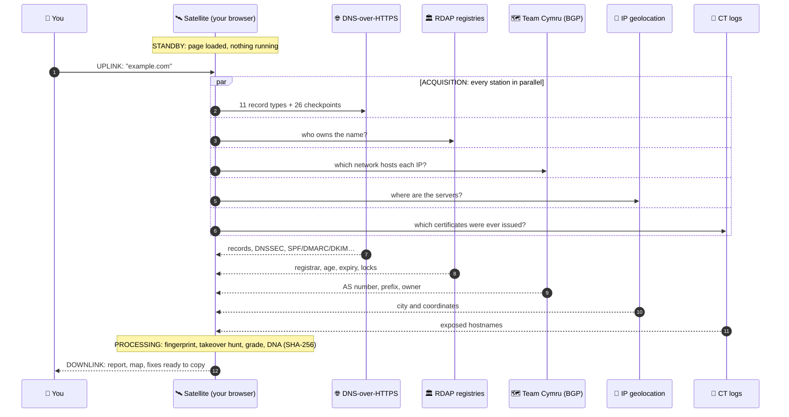
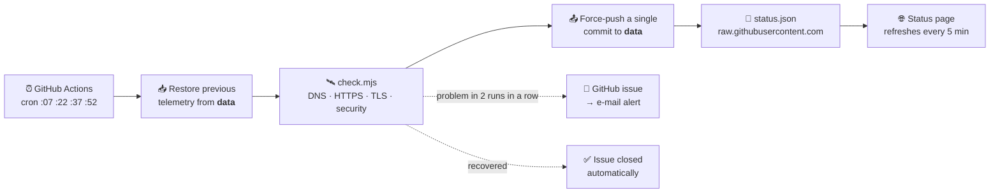

<div align="center">

# 🛰️DOMAIN X-RAY - url-status

### A personal satellite for any domain on the Internet

*Parked in orbit, always in standby. Call it with a domain name and it wakes up, interrogates six ground stations, and relays everything back to you in seconds. No backend. No API keys. Nothing but your browser.*

[](https://url-status.gerivan.me/)
[](https://url-status.gerivan.me/#NS/gerivan.me)
[](https://url-status.gerivan.me/#NS/gerivan.me)

[](https://github.com/gerivanc/url-status/actions/workflows/dns-monitor.yml)


[](LICENSE)

**[🛰️ Satellite](https://url-status.gerivan.me/)** · **[🌐 Mirror on gerivan.me](https://gerivan.me/status.html#NS/gerivan.me)** · **[⚙️ Workflow runs](https://github.com/gerivanc/url-status/actions)** · **[📄 Telemetry](https://raw.githubusercontent.com/gerivanc/url-status/data/status.json)** · **[🚨 Incidents](https://github.com/gerivanc/url-status/issues?q=is%3Aissue)**

</div>

---

## 🌌 The idea

A communications satellite doesn't stop existing when nobody is talking to it. It stays in orbit, in standby, spending almost nothing. The moment a ground station calls, it **receives** the signal, **processes** it and **relays** it back, loaded with information.

[url-status.gerivan.me](https://url-status.gerivan.me/) works the same way, with two orbits:

| Orbit | What it does | Who powers it |
|---|---|---|
| 🛰️ **On-demand orbit: Domain X-Ray** | Any domain a visitor types is scanned live: registration, servers, networks, email security, certificates, attack surface, global DNS propagation and a security grade | The visitor's own browser, talking straight to public data sources |
| 📡 **Station-keeping orbit: 24/7 monitor** | The `gerivan.me` fleet is checked every 15 minutes even when nobody has the page open, with history, uptime and e-mail alerts | GitHub Actions, writing telemetry to the `data` branch |

## 🚀 Call the satellite

Open **[url-status.gerivan.me](https://url-status.gerivan.me/)**, type a domain and press **X-RAY**. Or point straight at a target:

```text
https://url-status.gerivan.me/#A/example.com      ← X-Ray + A-record propagation
https://url-status.gerivan.me/#MX/example.com     ← X-Ray + MX propagation
https://gerivan.me/status.html#NS/gerivan.me          ← mirror on the main site
```

Press <kbd>/</kbd> anywhere to jump to the search box, <kbd>R</kbd> to re-check, <kbd>E</kbd> to export.

## 🛰️ Mission profile



| Phase | What happens |
|---|---|
| 💤 **Standby** | The page is a single static HTML file on GitHub Pages. Until you call it, it costs nothing and sends nothing. |
| 📡 **Uplink** | You type a domain. The name is sanitised and becomes a shareable link (`#TYPE/domain`). |
| 🛰️ **Acquisition** | Six ground stations are queried in parallel. Every answer appears in the *Live recon log* the moment it lands. |
| 🧠 **Processing** | The satellite fingerprints the technology stack, hunts for dangling CNAMEs, grades the security posture and sequences the domain's DNA. |
| 📶 **Downlink** | Report on screen, server pinned on the world map with arcs from 21 cities, a fix for every finding, a `.zone` file and a JSON report. |

## 📦 Payload: what comes back

| Module | What you get | Source and standard |
|---|---|---|
| 🏛️ **Registration** | Registrar, creation date and age, days until expiry, EPP locks, abuse contact, lifetime bar | RDAP, [RFC 9083](https://www.rfc-editor.org/rfc/rfc9083) |
| 🗺️ **Infrastructure** | Every IP → AS number, owner and prefix, reverse DNS, geolocation, anycast detection, HTTPS/`www`/HTTP-3 reachability, nameserver network diversity | Team Cymru IP→ASN over DNS · ipwho.is |
| ✉️ **Email security** | SPF with recursive lookup count (limit 10), DMARC with inherited policy, DKIM across 38 common selectors with key-size estimate, MTA-STS, TLS-RPT, BIMI, Null MX | [RFC 7208](https://www.rfc-editor.org/rfc/rfc7208) · [7489](https://www.rfc-editor.org/rfc/rfc7489) · [6376](https://www.rfc-editor.org/rfc/rfc6376) · [8461](https://www.rfc-editor.org/rfc/rfc8461) · [8460](https://www.rfc-editor.org/rfc/rfc8460) · [7505](https://www.rfc-editor.org/rfc/rfc7505) |
| 🧩 **Technology fingerprint** | DNS host, CDN, mail provider, outbound senders, CAs and verified SaaS. Hover any service to see **the exact record that gave it away** | Public DNS records |
| 🔏 **Attack surface** | Every hostname ever published in a certificate, each resolved live; dangling CNAMEs flagged as possible **subdomain takeover** | Certificate Transparency, [RFC 9162](https://www.rfc-editor.org/rfc/rfc9162) |
| 🛡️ **Security grade** | A+ to F with copy-paste fixes. The CAA suggestion is built from the CAs in the domain's own certificate history | All of the above |
| 🧬 **Domain DNA** | SHA-256 of NS · MX · TXT · CAA · DS · CNAME, drawn as a double helix. On the next scan it reports any **mutation** with an exact diff | WebCrypto, computed locally |
| 🌍 **Propagation** | The same record seen from 21 cities (EDNS Client Subnet) and 5 public resolvers, with consensus, heartbeat and DNS Doctor | [RFC 7871](https://www.rfc-editor.org/rfc/rfc7871) |
| 🧾 **Zone snapshot** | Everything public about the name as a zone file, with the SOA serial decoded ("last edited on…") | DNS |

## 📡 Ground stations

| Station | Used for | What leaves your browser |
|---|---|---|
| Google Public DNS · Cloudflare · Quad9 (DoH) | All DNS lookups, with hedged requests: Google first, the others join after 900 ms | The domain being scanned |
| [rdap.org](https://about.rdap.org/) → the TLD registry | Registration data | The registrable domain |
| Team Cymru (`origin.asn.cymru.com`, over DNS) | IP → autonomous system | Server IPs, as DNS names |
| ipwho.is (fallback ipapi.co) | Server geolocation | **Server** IPs only, never yours |
| Cert Spotter (fallback crt.sh) | Certificate Transparency | The registrable domain |
| WebCrypto | DNA hash | Nothing (local) |

Every module degrades gracefully. If a station is down or rate-limited, its card says so and the rest of the scan continues.

## 🛡️ Privacy and security model

- **No backend, no cookies, no analytics, no accounts.** The satellite is one static HTML file.
- **Hash-locked CSP.** `default-src 'none'` and a `script-src` that allows only the SHA-256 of the inline script. Any injected or altered script is refused by the browser.
- **Minimal disclosure.** Third parties only receive the domain being scanned or its server IPs.
- **Local memory.** DNA baselines and history live in your browser's `localStorage` and never leave it.

## 📡 Station-keeping orbit: the 24/7 monitor

While the X-Ray answers on demand, a GitHub Actions workflow keeps the `gerivan.me` fleet under watch every 15 minutes, even when nobody has the page open.

| Host | Record | Expected | Website |
|---|---|---|---|
| `gerivan.me` | **NS** · **A** | Porkbun nameservers · GitHub Pages IPs | [gerivan.me](https://gerivan.me) |
| `dnapass.gerivan.me` | **CNAME** | `gerivanc.github.io` | [🧬 DNAPass](https://dnapass.gerivan.me) |
| `entropy.gerivan.me` | **CNAME** | `gerivanc.github.io` | [🔐 EntroPy](https://entropy.gerivan.me) |
| `transformers.gerivan.me` | **CNAME** | `gerivanc.github.io` | [🧠 Transformers](https://transformers.gerivan.me) |
| `xphrase.gerivan.me` | **CNAME** | `gerivanc.github.io` | [🚀 XPhrase](https://xphrase.gerivan.me) |



### 🚦 Status levels

| Status | Meaning |
|---|---|
| 🟢 **operational** | Every DNS, HTTPS and certificate check passed and all checkpoints agree |
| 🟡 **degraded** | A subdomain is down, a checkpoint disagrees (propagation in progress), a CNAME points somewhere unexpected or a certificate expires within 14 days |
| 🔴 **outage** | The apex `gerivan.me` stops resolving or its website is unreachable |
| ⚪ **unknown** | No checkpoint could be reached |

Uptime counts time **without a full outage**.

<details>
<summary><b>🔧 Monitor configuration</b></summary>

Edit [`monitor/config.json`](monitor/config.json) straight in the browser (✏️):

| Key | Default | Meaning |
|---|---|---|
| `zone` | `gerivan.me` | Apex domain (NS + A + HTTPS) |
| `subdomains` | `dnapass`, `entropy`, `transformers`, `xphrase` | Hosts checked as CNAME + HTTPS |
| `expectCname` | `gerivanc.github.io` | Expected CNAME target |
| `certWarnDays` | `14` | Days before expiry that count as degraded |
| `historyDays` · `dailyDays` | `7` · `90` | Data retention |
| `alerts.githubIssues` | `true` | Open/close incident issues |
| `alerts.confirmRuns` | `2` | Failed runs in a row before an incident opens |

</details>

<details>
<summary><b>🧾 status.json at a glance</b></summary>

```jsonc
{
  "generatedAt": "2026-11-22T17:08:57Z",
  "overall": "operational",          // operational | degraded | outage | unknown
  "reasons": [],                      // human-readable problems, if any
  "checks": [ /* NS, A and every CNAME: majority answer, agree/reach, divergent checkpoints */ ],
  "https":  [ /* code, ms, cert.daysLeft, cert.issuer per host */ ],
  "security": { "dnssec": "…", "caa": [], "spf": "…", "dmarc": "…" },
  "uptime": { "h24": 100, "d7": 100, "d30": 100, "d90": 100 },
  "daily":  [ /* 90 daily buckets */ ],
  "incident": null,                   // ongoing incident, if any
  "incidents": [ /* last 10 */ ]
}
```

</details>

## 🧯 Signal lost? Troubleshooting

| Symptom | Likely cause | What to do |
|---|---|---|
| Grade shows ⛔ **DoH blocked**, resolvers *silently dropped* | A DNS filter with "block DoH bypass" (NextDNS, AdGuard, Control D, Pi-hole/AdGuard Home) or a firewall/antivirus | Allow `dns.google`, `cloudflare-dns.com` and `dns.quad9.net`, or test from another network (e.g. phone hotspot) |
| ⛔ **DoH blocked**, resolvers *refused instantly* | A browser extension, or a filter answering `0.0.0.0` | Try a private window with extensions off |
| Registration card: *RDAP unavailable* | Some ccTLD registries don't offer RDAP or block browser (CORS) requests | Expected for those TLDs; the rest of the scan still works |
| Certificates card empty | CT services rate-limit anonymous use | Wait a minute and rescan, or open the crt.sh link in the card |
| Monitor card: *stale data* | GitHub delayed or paused the scheduled workflow | **Actions → DNS monitor → Run workflow** (or *Enable workflow* after 60 days without activity) |

## 📁 Repository layout

```text
main                                          data  (single commit, overwritten every run)
├─ docs/                    ◀ GitHub Pages    ├─ status.json   ◀ read by the satellite
│  ├─ index.html            the satellite     ├─ history.json  rolling 7 days
│  ├─ CNAME                 url-status.gerivan.me   ├─ daily.json    90 daily buckets
│  └─ .nojekyll                               ├─ state.json    incident tracking
├─ .github/workflows/                         └─ README.md
│  └─ dns-monitor.yml       ◀ 24/7 monitor ("DNS monitor")
├─ monitor/
│  ├─ check.mjs             zero-dependency checker (Node 20)
│  └─ config.json
├─ LICENSE
└─ README.md
```

## 🛠️ Editing the satellite

`docs/index.html` is protected by a hash-locked CSP, so **any edit to the inline `<script>` requires updating the hash** in the `Content-Security-Policy` meta tag, or the browser will refuse to run it. The hash covers the exact bytes, line endings included (CRLF ≠ LF).

```bash
python3 - <<'PY'
import re, hashlib, base64, pathlib
p = pathlib.Path("docs/index.html"); s = p.read_bytes().decode("utf-8")
js = re.search(r"<script>(.*?)</script>", s, re.S).group(1)
h = base64.b64encode(hashlib.sha256(js.encode()).digest()).decode()
p.write_bytes(re.sub(r"script-src 'sha256-[^']+'", f"script-src 'sha256-{h}'", s).encode("utf-8"))
print("script-src sha256-" + h)
PY
```

Edits to HTML or CSS alone don't affect the hash.

## ▶️ Operations

- **Run the monitor now:** [Actions](https://github.com/gerivanc/url-status/actions) → **DNS monitor** → **Run workflow**. Use a new run; *Re-run jobs* repeats an old commit.
- **Alerts:** keep e-mail enabled for *Watching* in [notification settings](https://github.com/settings/notifications).
- **Keep it public:** GitHub Actions is free and unlimited for public repositories.
- **Delays:** scheduled runs can start a few minutes late; the page flags data as *stale* after 45 minutes without a run.

---

<div align="center">

*Standby in orbit · awake on call · relaying everything it hears* 🛰️

Made by **[Gerivan Costa](https://github.com/gerivanc)** · Part of the **[gerivan.me](https://gerivan.me)** digital universe

<sub>MIT License · © 2025-2026 Gerivan Costa dos Santos</sub>

</div>
