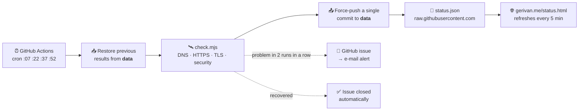

<div align="center">

# 🛰️ gerivan-status

### 24/7 DNS propagation & uptime monitor for [gerivan.me](https://gerivan.me)

*Checks every 15 minutes from 26 checkpoints around the world, even when nobody has the status page open.*

[](https://gerivan.me/status.html)
[](https://gerivan.me/status.html)
[](https://gerivan.me/status.html)

[](https://github.com/gerivanc/gerivan-status/actions/workflows/npm-publish-github-packages.yml)


[](LICENSE)

**[🌐 Live status page](https://gerivan.me/status.html)** · **[⚙️ Workflow runs](https://github.com/gerivanc/gerivan-status/actions)** · **[📄 Raw data](https://raw.githubusercontent.com/gerivanc/gerivan-status/data/status.json)** · **[🚨 Incidents](https://github.com/gerivanc/gerivan-status/issues?q=is%3Aissue)**

</div>

---

## ✨ Highlights

| | |
|---|---|
| 🌍 **Global propagation** | 21 cities through Google Public DNS + EDNS Client Subnet ([RFC 7871](https://www.rfc-editor.org/rfc/rfc7871)), from São Paulo and Santa Cruz do Sul to Tokyo and Sydney, plus 5 public resolvers |
| 🔐 **HTTPS + TLS** | Real HTTP status code, response time, trust chain and certificate expiry (warns at 14 days) |
| 🛡️ **Security snapshot** | DNSSEC, CAA, SPF and DMARC on every run |
| 🚨 **Free e-mail alerts** | Opens a GitHub issue when a problem is confirmed and closes it automatically on recovery |
| 📊 **90-day history** | Uptime for 24 h · 7 d · 30 d · 90 d and a daily bar chart on the status page |
| 🪶 **Tiny footprint** | Zero dependencies; results live on a single-commit `data` branch, so the repo never grows |

## 🎯 Monitored targets

| Host | Record | Expected | Website |
|---|---|---|---|
| `gerivan.me` | **NS** · **A** | Porkbun nameservers · GitHub Pages IPs | [gerivan.me](https://gerivan.me) |
| `dnapass.gerivan.me` | **CNAME** | `gerivanc.github.io` | [🧬 DNAPass](https://dnapass.gerivan.me) |
| `entropy.gerivan.me` | **CNAME** | `gerivanc.github.io` | [🔐 EntroPy](https://entropy.gerivan.me) |
| `transformers.gerivan.me` | **CNAME** | `gerivanc.github.io` | [🧠 Transformers](https://transformers.gerivan.me) |
| `xphrase.gerivan.me` | **CNAME** | `gerivanc.github.io` | [🚀 XPhrase](https://xphrase.gerivan.me) |

## ⚙️ How it works



<details>
<summary><b>📁 Repository layout</b></summary>

```text
main                                          data  (single commit, overwritten every run)
├─ .github/workflows/
│  └─ npm-publish-github-packages.yml  ◀ runs   ├─ status.json   ◀ read by status.html
├─ gerivan-status/                              ├─ history.json  rolling 7 days
│  └─ monitor/                                  ├─ daily.json    90 daily buckets
│     ├─ check.mjs                              ├─ state.json    incident tracking
│     └─ config.json                            └─ README.md
├─ LICENSE
└─ README.md
```

> `gerivan-status/.github/workflows/dns-monitor.yml` is an unused copy: GitHub only runs workflows from the root `.github/` folder.

</details>

## 🚦 Status levels

| Status | Meaning |
|---|---|
| 🟢 **operational** | Every DNS, HTTPS and certificate check passed and all checkpoints agree |
| 🟡 **degraded** | A subdomain is down, a checkpoint disagrees (propagation in progress), a CNAME points somewhere unexpected or a certificate expires within 14 days |
| 🔴 **outage** | The apex `gerivan.me` stops resolving or its website is unreachable |
| ⚪ **unknown** | No checkpoint could be reached |

Uptime counts time **without a full outage**.

## 🔧 Configuration

Edit [`gerivan-status/monitor/config.json`](gerivan-status/monitor/config.json) straight in the browser (✏️):

| Key | Default | Meaning |
|---|---|---|
| `zone` | `gerivan.me` | Apex domain (NS + A + HTTPS) |
| `subdomains` | `dnapass`, `entropy`, `transformers`, `xphrase` | Hosts checked as CNAME + HTTPS |
| `expectCname` | `gerivanc.github.io` | Expected CNAME target |
| `certWarnDays` | `14` | Days before expiry that count as degraded |
| `historyDays` · `dailyDays` | `7` · `90` | Data retention |
| `alerts.githubIssues` | `true` | Open/close incident issues |
| `alerts.confirmRuns` | `2` | Failed runs in a row before an incident opens |

<details>
<summary><b>🧾 status.json at a glance</b></summary>

```jsonc
{
  "generatedAt": "2026-11-22T17:08:57Z",
  "overall": "operational",          // operational | degraded | outage | unknown
  "reasons": [],                      // human-readable problems, if any
  "checks": [ /* NS, A and every CNAME: majority answer, agree/reach, divergent checkpoints */ ],
  "https":  [ /* code, ms, cert.daysLeft, cert.issuer per host */ ],
  "security": { "dnssec": "…", "caa": [], "spf": "…", "dmarc": "…" },
  "uptime": { "h24": 100, "d7": 100, "d30": 100, "d90": 100 },
  "daily":  [ /* 90 daily buckets */ ],
  "incident": null,                   // ongoing incident, if any
  "incidents": [ /* last 10 */ ]
}
```

</details>

## ▶️ Operations

- **Run now:** [Actions](https://github.com/gerivanc/gerivan-status/actions) → **DNS monitor** → **Run workflow**. Use a new run; *Re-run jobs* repeats an old commit.
- **Alerts:** keep e-mail enabled for *Watching* in [notification settings](https://github.com/settings/notifications).
- **Paused schedule:** GitHub may pause scheduled workflows after 60 days without repository activity. Re-enable it under **Actions → DNS monitor → Enable workflow**.
- **Keep it public:** GitHub Actions is free and unlimited for public repositories.
- **Delays:** scheduled runs can start a few minutes late; the status page flags the data as *stale* after 45 minutes without a run.

---

<div align="center">

Made with 🛰️ by **[Gerivan Costa](https://github.com/gerivanc)** · Part of the **[gerivan.me](https://gerivan.me)** digital universe

<sub>MIT License · © 2025-2026 Gerivan Costa dos Santos</sub>

</div>
